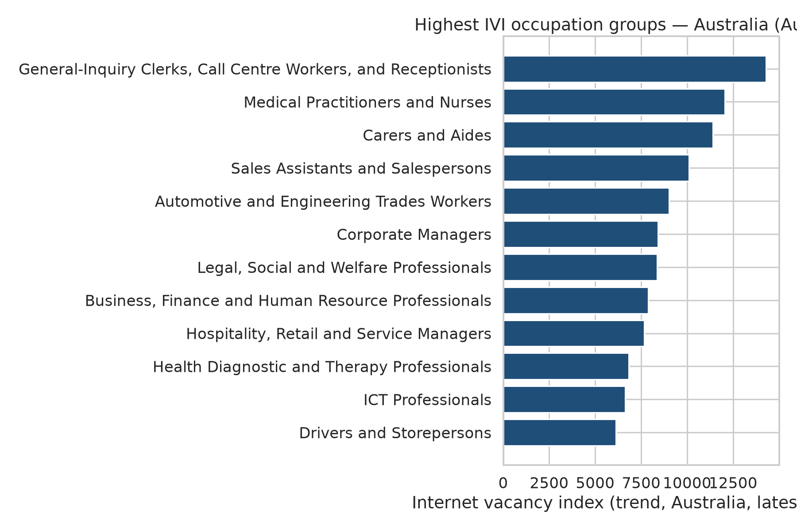
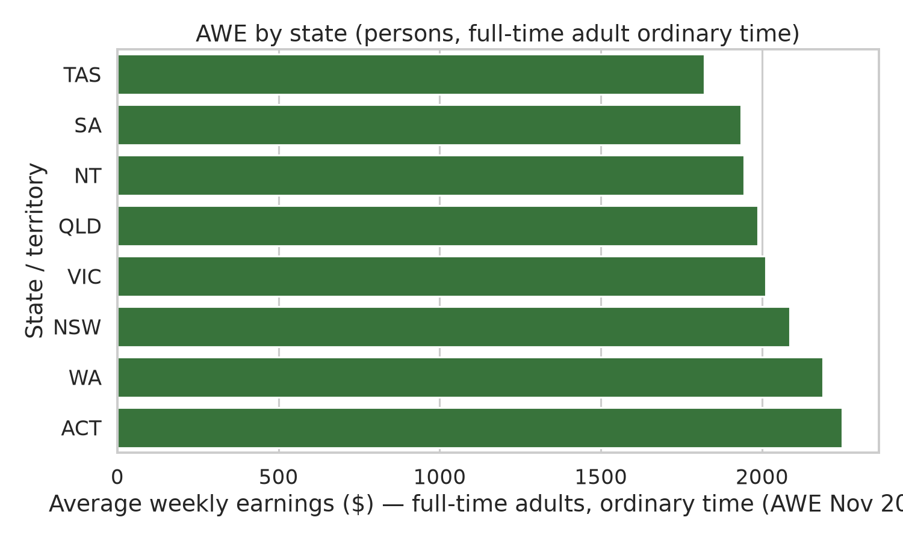
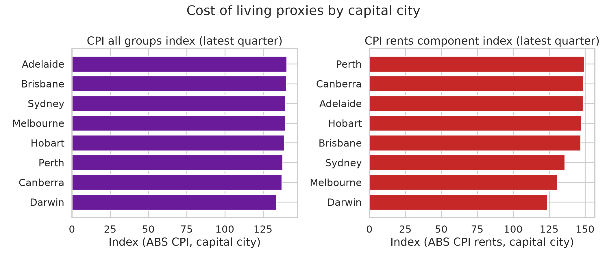
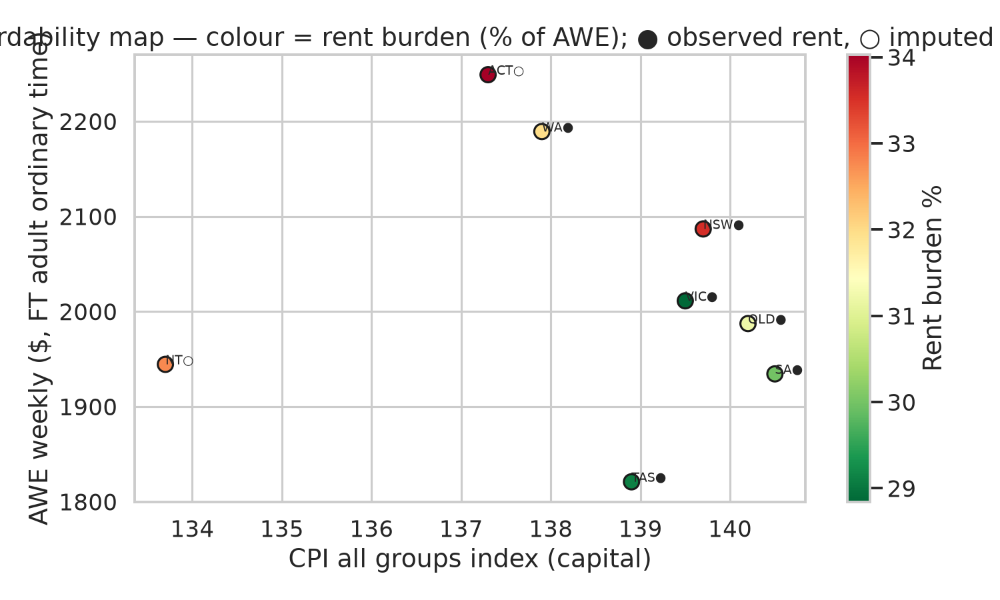

# Australian labour market: demand, earnings, and affordability

Reproducible analysis of **occupation demand** (especially for skilled migrants), **state earnings**, **capital-city cost of living**, and a transparent **affordability index** linking pay to price and rent proxies. All figures are built from **official public sources** downloaded by `src/download/download_all.py` and recorded in [`data/SOURCES.md`](data/SOURCES.md).

## Reproduce

```bash
python3 -m venv .venv && source .venv/bin/activate
pip install -r requirements.txt
make all          # or: python run_all.py
```

- **Data only:** `make data`
- **Analysis only** (requires raw files): `make analyze`

Outputs: `outputs/figures/*.png`, `outputs/tables/*.csv`, `data/processed/*.csv`.

## Data sources used

| Provider | Dataset | Role in this project |
| --- | --- | --- |
| Jobs and Skills Australia | [Occupation Shortage List 2025](https://www.jobsandskills.gov.au/) (XLSX) | National/state shortage ratings (ANZSCO 2022, 6-digit) |
| Jobs and Skills Australia | [Internet Vacancy Index (IVI)](https://www.jobsandskills.gov.au/) ANZSCO2 by state, Aug 2025 | Vacancy levels and YoY change by occupation group |
| Department of Home Affairs | [Core Skills Occupation List (CSOL)](https://immi.homeaffairs.gov.au/) PDF | Skilled visa occupation eligibility (ANZSCO codes) |
| Federal Register of Legislation | [LIN 19/051](https://www.legislation.gov.au/F2019L00278/latest) PDF | MLTSSL / STSOL / ROL occupation codes |
| ABS 6302.0 | Average Weekly Earnings, Nov 2025, Table 11 by state | Full-time adult **ordinary time** weekly earnings |
| ABS 6306.0 | Employee Earnings and Hours, May 2025, Table 9 | All-employee average weekly **total cash** earnings (sensitivity) |
| ABS 6401.0 | CPI, Dec quarter 2024, Tables 5 & 9 | All-groups and housing/rent indexes by capital |
| ABS 6467.0 | Selected Living Cost Indexes, Jun 2026 | Downloaded and archived; **not** used in main indexes (national household groups only in published cube) |
| ABS 6354.0 | Job Vacancies by state, Aug 2026 | Downloaded as official IVI supplement; not merged in current charts |
| NSW Government / Fair Trading | Rental bond lodgements, Nov 2025 | **Observed** median weekly rent (Sydney anchor) |

Full URLs, access dates, and SHA-256 hashes: [`data/manifest.json`](data/manifest.json) and [`data/SOURCES.md`](data/SOURCES.md).

### Unavailable or partial

- **JSA direct host:** In some environments `jobsandskills.gov.au` file URLs fail; the downloader retries via **Internet Archive Wayback** pointing at the same official file URL (noted in the manifest when used).
- **CPI Rents by capital:** ABS Table 9 publishes **rent** indexes only for **Sydney and Melbourne** in the downloaded cube. Other capitals use **CPI Housing** as a rent proxy (`rent_index_source` column in outputs).
- **Median rent outside NSW:** Only NSW publishes machine-readable bond lodgements used here; other cities’ rents are **imputed** from the NSW median and CPI rent/housing ratios (see methodology).

---

## 1. Occupation demand and migrants

### Shortage + skilled visa overlap

From the **2025 Occupation Shortage List** (916 occupations):

| Metric | Count |
| --- | ---: |
| National shortage (S / R / M) | **273** |
| Shortage **and** on CSOL | **227** |
| Shortage **and** on any legislative list (MLTSSL / STSOL / ROL) | **237** |

High-priority examples (shortage + CSOL + MLTSSL) include Actuary (224111), Aeronautical Engineer (233911), Agricultural Consultant (234111), and Construction Project Manager (133111). Full table: [`outputs/tables/top_shortage_skilled_visa_occupations.csv`](outputs/tables/top_shortage_skilled_visa_occupations.csv).

### Internet Vacancy Index (Australia, Aug 2025)

Highest IVI occupation **groups** (sub-major, national trend):

1. General-Inquiry Clerks, Call Centre Workers, and Receptionists — **14,283** vacancies  
2. Medical Practitioners and Nurses — **12,040**  
3. Carers and Aides — **11,406**  



IVI measures **advertised vacancies** (not hires) and uses a different ANZSCO aggregation than the 6-digit OSL; interpret migrant demand by combining **OSL + visa lists**, and IVI for **labour demand momentum**.

---

## 2. Earnings by state / capital

**AWE Nov 2025** — persons, full-time, adult, **ordinary time** earnings ($/week):

| Rank | State | Capital | AWE ($/week) | YoY % |
| ---: | --- | --- | ---: | ---: |
| 1 | ACT | Canberra | **2,249.0** | 22.9 |
| 2 | WA | Perth | 2,189.2 | 22.5 |
| 3 | NSW | Sydney | 2,086.8 | 23.6 |
| 8 | TAS | Hobart | 1,820.9 | 25.4 |



**EEH May 2025** (all employees, average weekly total cash) ranks similarly, with ACT highest at **$1,899.7** — see [`outputs/tables/earnings_by_state.csv`](outputs/tables/earnings_by_state.csv). AWE is the headline series for **full-time adult ordinary time** as requested.

---

## 3. Cost of living by capital

**CPI all groups** (Dec quarter 2024, index levels):

| Capital | CPI index | YoY % |
| --- | ---: | ---: |
| Adelaide | **140.5** | 2.48 |
| Darwin (lowest) | **133.7** | 1.67 |

**Rent / housing proxy** (see `rent_index_source`):

| Capital | Index | Source |
| --- | ---: | --- |
| Sydney | 136.0 | CPI Rents |
| Melbourne | 130.6 | CPI Rents |
| Brisbane | 146.9 | CPI Housing (proxy) |

**NSW observed rent:** median weekly rent from Nov 2025 bond lodgements = **$700/week** (n ≈ 23k lodgements after basic cleaning).



---

## 4. Affordability methodology

We report two complementary metrics at the **state capital** level (earnings matched to each state’s primary capital).

### A. Real earnings index (purchasing-power proxy)

\[
\text{real\_earnings\_index} = \frac{\text{AWE weekly (\$)}}{\text{CPI all groups index}} \times 100
\]

Higher values imply more weekly pay per unit of city-wide consumer prices.

### B. Imputed rent burden (%)

1. Anchor: **NSW median weekly rent** = $700 (bond data).  
2. For each capital \(c\):  
   \(\text{rent\_hat}_c = 700 \times \dfrac{\text{rent/housing index}_c}{\text{rent index}_{\text{Sydney}}}\)  
3. \(\text{rent\_burden\_pct} = 100 \times \text{rent\_hat}_c / \text{AWE}_c\)

**Residual weekly income** = AWE − rent_hat (crude “after rent” cushion, before tax and other costs).

### Results (base definition)

| State | Capital | AWE | Real earnings index | Rent burden % | Residual $/week |
| --- | --- | ---: | ---: | ---: | ---: |
| ACT | Canberra | 2,249 | **1,638** | 34.0 | 1,484 |
| WA | Perth | 2,189 | 1,588 | 35.1 | 1,420 |
| TAS | Hobart | 1,821 | 1,311 | **41.7** | 1,062 |



### Sensitivity checks ([`outputs/tables/affordability_sensitivity.csv`](outputs/tables/affordability_sensitivity.csv))

| Variant | Change | Effect |
| --- | --- | --- |
| **S1** | EEH total cash instead of AWE ordinary time | Rankings similar; rent burden rises (lower denominator), e.g. Hobart **52.5%** |
| **S2** | Scale imputed rent using **CPI all groups** instead of rent/housing index | Slightly lower burdens in high-housing-index cities |

---

## 5. Conclusions

1. **Migration-aligned shortages** are widespread: **227** occupations are simultaneously in national shortage and on the **CSOL**; legislative lists add overlapping pathways (MLTSSL/STSOL/ROL).  
2. **Nominal pay** is highest in **ACT/WA**, then NSW; Tasmania is lowest on AWE but still saw strong **YoY growth** (~25%).  
3. **Price levels** (CPI) vary modestly across capitals compared with **earnings** spreads; **Canberra** combines high AWE with a mid-range CPI, yielding the strongest **real earnings index** in this framework.  
4. **Housing cost pressure** is most acute in **Hobart** and **Adelaide** on the imputed rent-burden measure, driven by lower AWE and relatively high housing/rent indexes—not only Sydney/Melbourne.  
5. **IVI** shows very large vacancy counts in clerical/call-centre and health/care groups; migrant planning should still prioritise **visa-list + shortage** alignment at 6-digit ANZSCO.

### Limitations

- Earnings (Nov 2025 AWE) and CPI (Dec 2024 quarter) are **not contemporaneous**.  
- Rent imputation is **not** a substitute for local bond or census rent statistics.  
- PDF parsing of visa lists may miss formatting edge cases; codes are validated against CSOL overlap counts.  
- No tax, household composition, or transport costs—indexes are **illustrative**, not welfare measures.

---

## Resumen en español

Este repositorio analiza el mercado laboral australiano con datos oficiales descargables. **273** ocupaciones presentan escasez nacional; **227** de ellas figuran también en la lista CSOL de visados calificados. Los salarios semanales más altos (tiempo ordinario, adultos a tiempo completo, AWE nov-2025) están en **ACT (Canberra: A$2.249)** y **WA (Perth: A$2.189)**; los más bajos en **Tasmania (A$1.821)**. El índice de **ingreso real** (salario dividido por el IPC de la ciudad) favorece a **Canberra**. La **carga de alquiler imputada** es mayor en **Hobart (~42 % del salario)** usando la mediana de alquiler de NSW (A$700/semana) escalada por el IPC de vivienda/alquiler. Las vacantes IVI más altas (ago-2025) están en atención al cliente y salud. Para reproducir: `make all`. Fuentes y hashes en `data/SOURCES.md`.

---

## Repository layout

```
src/download/     # Official downloads + manifest
src/io/           # Parsers (ABS, JSA, PDF lists, NSW rents)
src/analysis/     # Analysis steps → figures/tables
data/raw/         # Downloaded files (large xlsx/pdf gitignored; re-fetch with make data)
data/processed/   # Cleaned CSV + summary JSON
outputs/figures/  # PNG charts for the report
run_all.py        # End-to-end pipeline
```

## Licence and attribution

Use ABS and Australian Government data subject to their terms. Cite original publications when republishing statistics.
