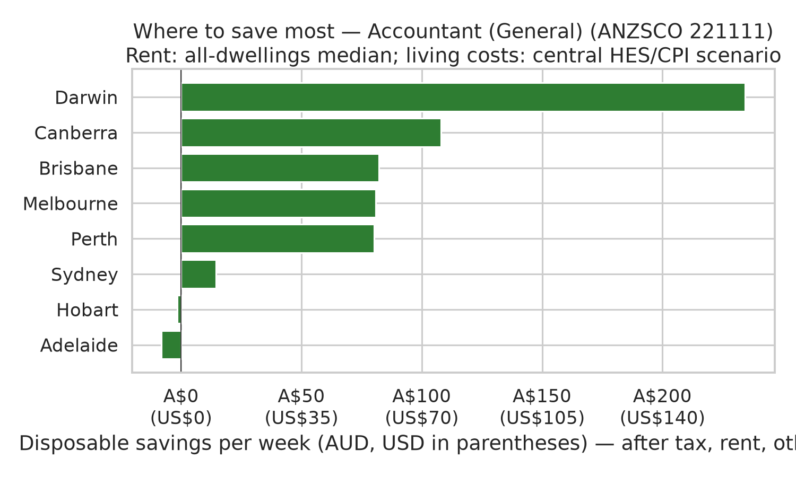
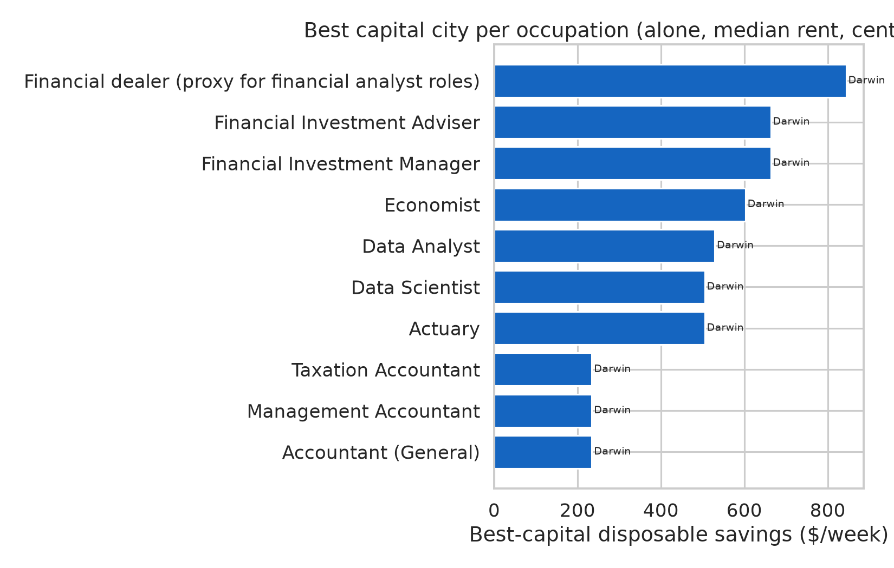

# Australian labour market: demand, earnings, and affordability

Reproducible analysis of **occupation demand** (especially for skilled migrants), **state earnings**, **capital-city cost of living**, and a transparent **affordability index** linking pay to price and rent proxies. All figures are built from **official public sources** downloaded by `src/download/download_all.py` and recorded in [`data/SOURCES.md`](data/SOURCES.md).

## Reproduce

```bash
python3 -m venv .venv && source .venv/bin/activate
pip install -r requirements.txt
make all          # or: python run_all.py
```

- **Data only:** `make data`
- **Analysis only** (requires raw files): `make analyze`

Outputs: `outputs/figures/*.png`, `outputs/tables/*.csv`, `data/processed/*.csv`.

**Currency:** Monetary tables and chart axes use **AUD** with **USD** equivalents from the latest **RBA Table F11** AUD/USD rate recorded in [`data/manifest.json`](data/manifest.json) (`aud_usd`). All conversions must go through [`src/fx.py`](src/fx.py) — do not hard-code rates in new outputs.

## Data sources used

| Provider | Dataset | Role in this project |
| --- | --- | --- |
| Jobs and Skills Australia | [Occupation Shortage List 2025](https://www.jobsandskills.gov.au/) (XLSX) | National/state shortage ratings (ANZSCO 2022, 6-digit) |
| Jobs and Skills Australia | [Internet Vacancy Index (IVI)](https://www.jobsandskills.gov.au/) ANZSCO2 by state, Aug 2025 | Vacancy levels and YoY change by occupation group |
| Department of Home Affairs | [Core Skills Occupation List (CSOL)](https://immi.homeaffairs.gov.au/) PDF | Skilled visa occupation eligibility (ANZSCO codes) |
| Federal Register of Legislation | [LIN 19/051](https://www.legislation.gov.au/F2019L00278/latest) PDF | MLTSSL / STSOL / ROL occupation codes |
| ABS 6302.0 | Average Weekly Earnings, Nov 2025, Table 11 by state | Full-time adult **ordinary time** weekly earnings |
| ABS 6306.0 | Employee Earnings and Hours, May 2025, Table 9 | All-employee average weekly **total cash** earnings (sensitivity) |
| ABS 6401.0 | CPI, Dec quarter 2024, Tables 5 & 9 | All-groups and housing/rent indexes by capital |
| ABS 6467.0 | Selected Living Cost Indexes, Jun 2026 | Downloaded and archived; **not** used in main indexes (national household groups only in published cube) |
| ABS 6354.0 | Job Vacancies by state, Aug 2026 | Downloaded as official IVI supplement; not merged in current charts |
| NSW Government / Fair Trading | Rental bond lodgements, Nov 2025 | **Observed** median weekly rent (NSW bonds; Sydney proxy) |
| VIC Homes Victoria / DFFH | Rental Report tables, Sep quarter 2025 | **Observed** metropolitan Melbourne median |
| QLD RTA | Quarterly median rents (bond lodgements) | **Observed** Brisbane (C) all-dwellings median |
| WA Consumer Protection (AHDAP) | Monthly rental bond lodgements | **Observed** Greater Perth median |
| SA Housing Trust / CBS | Private Rent Report postcode strata | **Observed** metropolitan Adelaide median |
| TAS Dept of Justice | Rental bond open data, Nov 2025 | **Observed** Greater Hobart median |
| ABS 6306.0 | EEH May 2025, DO011 Table 1 | **National** average weekly cash earnings by 4-digit ANZSCO occupation |
| ABS 6530.0 | HES 2015-16 summary | Lone-person **non-housing** spending anchor (CPI-scaled living costs) |
| ATO | [Resident tax rates 2025–26](https://www.ato.gov.au/tax-rates-and-codes/tax-rates-australian-residents) | After-tax income (+ 2% Medicare levy in code; super excluded) |
| RBA | [Table F11 — Exchange rates](https://www.rba.gov.au/statistics/tables/) (`f11-data.csv`) | **AUD/USD** for USD columns and chart labels (latest monthly observation in manifest) |

Full URLs, access dates, SHA-256 hashes, and the active **AUD/USD** rate: [`data/manifest.json`](data/manifest.json) and [`data/SOURCES.md`](data/SOURCES.md).

Observed medians by capital: [`outputs/tables/median_weekly_rents_by_capital.csv`](outputs/tables/median_weekly_rents_by_capital.csv) (`rent_observed` flag in [`outputs/tables/affordability_index.csv`](outputs/tables/affordability_index.csv)).

### Unavailable or partial

- **JSA direct host:** In some environments `jobsandskills.gov.au` file URLs fail; the downloader retries via **Internet Archive Wayback** pointing at the same official file URL (noted in the manifest when used).
- **CPI Rents by capital:** ABS Table 9 publishes **rent** indexes only for **Sydney and Melbourne** in the downloaded cube. Other capitals use **CPI Housing** as a rent proxy (`rent_index_source` column in outputs).
- **VIC / SA hosts:** `dffh.vic.gov.au` and `data.sa.gov.au` may block automated downloads; the pipeline uses **Wayback** (VIC) or a **CC BY mirror** of the same SA Private Rent Report release (noted in the manifest).
- **ACT and NT medians:** No open ACT Revenue bond rent series and no NT bond microdata in this pipeline; **Canberra** and **Darwin** use CPI-scaled imputation (clearly flagged). NT Economy / REINT publish separate house and unit medians only.

---

## 1. Occupation demand and migrants

### Shortage + skilled visa overlap

From the **2025 Occupation Shortage List** (916 occupations):

| Metric | Count |
| --- | ---: |
| National shortage (S / R / M) | **273** |
| Shortage **and** on CSOL | **227** |
| Shortage **and** on any legislative list (MLTSSL / STSOL / ROL) | **237** |

High-priority examples (shortage + CSOL + MLTSSL) include Actuary (224111), Aeronautical Engineer (233911), Agricultural Consultant (234111), and Construction Project Manager (133111). Full table: [`outputs/tables/top_shortage_skilled_visa_occupations.csv`](outputs/tables/top_shortage_skilled_visa_occupations.csv).

### Internet Vacancy Index (Australia, Aug 2025)

Highest IVI occupation **groups** (sub-major, national trend):

1. General-Inquiry Clerks, Call Centre Workers, and Receptionists — **14,283** vacancies  
2. Medical Practitioners and Nurses — **12,040**  
3. Carers and Aides — **11,406**  


IVI measures **advertised vacancies** (not hires) and uses a different ANZSCO aggregation than the 6-digit OSL; interpret migrant demand by combining **OSL + visa lists**, and IVI for **labour demand momentum**.

---

## 2. Earnings by state / capital

**AWE Nov 2025** — persons, full-time, adult, **ordinary time** earnings (AUD/week, USD at RBA F11 **0.6977** on **30-Sep-2026**):

| Rank | State | Capital | AWE (AUD / USD per week) | YoY % |
| ---: | --- | --- | ---: | ---: |
| 1 | ACT | Canberra | **A$2,249 (US$1,569)** | 22.9 |
| 2 | WA | Perth | A$2,189 (US$1,527) | 22.5 |
| 3 | NSW | Sydney | A$2,087 (US$1,456) | 23.6 |
| 8 | TAS | Hobart | A$1,821 (US$1,270) | 25.4 |


**EEH May 2025** (all employees, average weekly total cash) ranks similarly, with ACT highest at **A$1,900 (US$1,325)** — see [`outputs/tables/earnings_by_state.csv`](outputs/tables/earnings_by_state.csv) (AUD and USD columns). AWE is the headline series for **full-time adult ordinary time** as requested.

---

## 3. Cost of living by capital

**CPI all groups** (Dec quarter 2024, index levels):

| Capital | CPI index | YoY % |
| --- | ---: | ---: |
| Adelaide | **140.5** | 2.48 |
| Darwin (lowest) | **133.7** | 1.67 |

**Rent / housing proxy** (see `rent_index_source`):

| Capital | Index | Source |
| --- | ---: | --- |
| Sydney | 136.0 | CPI Rents |
| Melbourne | 130.6 | CPI Rents |
| Brisbane | 146.9 | CPI Housing (proxy) |

**Observed median weekly rents** (official bond / rental-report sources; see table for periods):

| Capital | Median rent (AUD / USD per week) | Period | Observed? |
| --- | ---: | --- | --- |
| Sydney (NSW bonds) | **A$700 (US$488)** | Nov 2025 | Yes |
| Melbourne | **A$580 (US$405)** | Sep quarter 2025 | Yes |
| Brisbane | **A$620 (US$433)** | Sep quarter 2025 | Yes |
| Perth | **A$700 (US$488)** | Nov 2025 | Yes |
| Adelaide (metro) | **A$580 (US$405)** | Apr–Jun 2026 | Yes |
| Hobart (Greater) | **A$530 (US$370)** | Nov 2025 | Yes |
| Canberra | A$765 (US$534) | CPI fallback | No |
| Darwin | A$637 (US$444) | CPI fallback | No |


---

## 4. Affordability methodology

We report two complementary metrics at the **state capital** level (earnings matched to each state’s primary capital).

### A. Real earnings index (purchasing-power proxy)

\[
\text{real\_earnings\_index} = \frac{\text{AWE weekly (\$)}}{\text{CPI all groups index}} \times 100
\]

Higher values imply more weekly pay per unit of city-wide consumer prices.

### B. Rent burden (%)

1. **Preferred:** official **median weekly rent** for the capital from bond lodgements or state rental reports (see `median_weekly_rents_by_capital.csv`).  
2. **Fallback (ACT, Darwin only):**  
   \(\text{rent\_hat}_c = 700 \times \dfrac{\text{rent/housing index}_c}{\text{rent index}_{\text{Sydney}}}\)  
   anchored to NSW Nov 2025 bond median $700.  
3. \(\text{rent\_burden\_pct} = 100 \times \text{median\_weekly\_rent} / \text{AWE}_c\)

**Residual weekly income** = AWE − median rent (crude “after rent” cushion, before tax and other costs).

### Results (base definition)

| State | Capital | AWE | Real earnings index | Rent burden % | Residual $/week |
| --- | --- | ---: | ---: | ---: | ---: |
| ACT | Canberra | 2,249 | **1,638** | **34.0** | 1,484 |
| WA | Perth | 2,189 | 1,588 | 32.0 | 1,489 |
| TAS | Hobart | 1,821 | 1,311 | 29.1 | 1,291 |


### Sensitivity checks ([`outputs/tables/affordability_sensitivity.csv`](outputs/tables/affordability_sensitivity.csv))

| Variant | Change | Effect |
| --- | --- | --- |
| **S1** | EEH total cash instead of AWE ordinary time | Rent burden rises (lower denominator), e.g. Hobart **36.7%**, Canberra **40.3%** |
| **S2** | CPI all-groups scaling for **imputed** cities only | Canberra **30.6%** (observed cities unchanged) |

---

## 5. Where can you save the most? (economics / finance / data professionals)

Occupation-level **disposable savings** by state capital:

\[
\text{disposable savings/week} = \text{after-tax weekly pay} - \text{rent} - \text{other living costs}
\]

### Method (all assumptions flagged in CSV)

| Step | Source | Notes |
| --- | --- | --- |
| Gross weekly pay | ABS **EEH May 2025** Table 1 (4-digit ANZSCO) | National occupation average; **× state EEH Table 9 / Australia** → state estimate (`earnings_is_state_estimate`) |
| After-tax pay | **ATO 2025–26** resident brackets + **2% Medicare** | Implemented in `src/io/ato_tax.py`; HTML archived in `data/raw/` |
| Rent | Bond / rental-report medians + scenarios | `alone_all_median`, `alone_1bed` (where published), `share_flat_half_2bed` (= **50%** of 2-bed median, flagged) |
| Other living costs | **HES 2015-16** lone-person non-housing anchor (~$572/wk in 2015-16 dollars), inflated and **CPI-scaled by capital** | Low / central / high = **±15%** (`living_cost_sensitivity`) |

Profiles (ANZSCO 2022): Actuary 224111, Economist 224311, Financial Investment Adviser/Manager 222311–222312, **Financial dealer 2222** (proxy where no “financial analyst” line in EEH), Accountants 221111–221113, Data Analyst 224114, Data Scientist 224115. Demand/visa context: [`outputs/tables/professional_occupations_visa_demand.csv`](outputs/tables/professional_occupations_visa_demand.csv) (OSL 2025, CSOL, LIN 19/051 lists, IVI sub-major groups Aug 2025).

### City ranking table (central living costs, alone, all-dwellings median rent)

Eight capitals ranked by **mean disposable savings** across Economist, Data Analyst, Financial Investment Adviser, Actuary, and Accountant (General) — same scenario as above. Values are **AUD/week** with **USD** at RBA F11 **0.6977** (30-Sep-2026). Darwin and Canberra use **CPI-imputed** medians (`rent_median_observed = false` in CSV).

| Rank | Capital | Mean (AUD / USD) | Economist | Data Analyst | Fin. investment adviser | Actuary | Accountant |
| ---: | --- | ---: | ---: | ---: | ---: | ---: | ---: |
| 1 | Darwin † | **A$507 (US$354)** | 603 / 421 | 529 / 369 | 663 / 463 | 505 / 352 | 234 / 163 |
| 2 | Canberra † | A$384 (US$268) | 480 / 335 | 407 / 284 | 541 / 377 | 383 / 267 | 108 / 75 |
| 3 | Perth | A$340 (US$237) | 430 / 300 | 360 / 251 | 493 / 344 | 337 / 235 | 80 / 56 |
| 4 | Brisbane | A$329 (US$230) | 414 / 289 | 348 / 243 | 475 / 331 | 326 / 228 | 82 / 57 |
| 5 | Melbourne | A$319 (US$223) | 401 / 280 | 337 / 235 | 459 / 320 | 316 / 221 | 81 / 56 |
| 6 | Sydney | A$263 (US$184) | 349 / 244 | 282 / 197 | 410 / 286 | 261 / 182 | 15 / 10 |
| 7 | Adelaide | A$213 (US$149) | 290 / 202 | 230 / 161 | 344 / 240 | 211 / 147 | −8 / −6 |
| 8 | Hobart | A$210 (US$146) | 283 / 197 | 226 / 158 | 334 / 233 | 207 / 145 | −2 / −1 |

† **Estimated rent** (CPI-imputed from NSW bond anchor).

**Among capitals with observed bond/report medians only**, **Perth** leads on mean disposable savings (**A$340 / US$237** per week across these five occupations) — verified in [`outputs/tables/city_savings_ranking_by_occupation.csv`](outputs/tables/city_savings_ranking_by_occupation.csv). Darwin and Canberra rank higher overall because NT/ACT pay relativity is strong while their rents are imputed, not observed.

### Occupation best / worst (same scenario)

| Occupation | Best city | Disposable (AUD / USD per week) | Worst city | Disposable (AUD / USD per week) |
| --- | --- | ---: | --- | ---: |
| Accountant (General) 221111 | Darwin | **A$234 (US$163)** | Adelaide | **A$−8 (US$−6)** |
| Economist 224311 | Darwin | **A$603 (US$421)** | Hobart | A$283 (US$197) |
| Financial Investment Adviser 222311 | Darwin | **A$663 (US$463)** | Hobart | A$334 (US$233) |
| Data Analyst 224114 | Darwin | **A$529 (US$369)** | Hobart | A$226 (US$158) |
| Actuary 224111 | Darwin | **A$505 (US$352)** | Hobart | A$207 (US$145) |

Full grid (all scenarios/sensitivities): [`outputs/tables/savings_by_city_detail.csv`](outputs/tables/savings_by_city_detail.csv) (AUD + USD columns). Per-occupation rankings: [`outputs/tables/savings_rankings_alone_median_central.csv`](outputs/tables/savings_rankings_alone_median_central.csv).





**Caveats:** No 6-digit EEH earnings by state (scaling is an estimate). HES living-cost anchor is **2015-16** (CPI-updated, not SLCI-by-city). Negative savings mean the central scenario spends more than after-tax pay after rent — treat as illustrative. **Visa pathways** are summarised from downloaded lists only; confirm current rules with [Home Affairs](https://immi.homeaffairs.gov.au/).

---

## 6. Conclusions

1. **Migration-aligned shortages** are widespread: **227** occupations are simultaneously in national shortage and on the **CSOL**; legislative lists add overlapping pathways (MLTSSL/STSOL/ROL).  
2. **Nominal pay** is highest in **ACT/WA**, then NSW; Tasmania is lowest on AWE but still saw strong **YoY growth** (~25%).  
3. **Price levels** (CPI) vary modestly across capitals compared with **earnings** spreads; **Canberra** combines high AWE with a mid-range CPI, yielding the strongest **real earnings index** in this framework.  
4. With **observed bond/report medians** for six capitals, **rent burden** is highest for **Canberra** and **Sydney** (~34%) on this crude measure; **Melbourne** is lower (~29%) at the Sep-2025 published median ($580/week). Hobart falls to **~29%** once Greater Hobart bond data ($530/week) replace CPI scaling.  
5. **IVI** shows very large vacancy counts in clerical/call-centre and health/care groups; migrant planning should still prioritise **visa-list + shortage** alignment at 6-digit ANZSCO.  
6. **Occupation-level savings** (EEH + ATO + observed rents): under the central scenario, **Darwin** leads overall (imputed NT rent); among **observed-rent** capitals, **Perth** leads the five-profile mean; **Adelaide** is weakest (accountants can show **negative** central savings). See §5.

### Limitations

- Earnings (Nov 2025 AWE) and CPI (Dec 2024 quarter) are **not contemporaneous**.  
- Rent periods **differ by source** (monthly bonds vs quarterly reports); earnings and CPI are not fully aligned either.  
- **ACT/NT** medians remain CPI-scaled fallbacks; ACT Revenue does not publish open bond rent microdata here.  
- PDF parsing of visa lists may miss formatting edge cases; codes are validated against CSOL overlap counts.  
- No tax, household composition, or transport costs—indexes are **illustrative**, not welfare measures (the §5 savings module adds tax and living costs but retains other limitations above).

---

## Resumen en español

Este repositorio analiza el mercado laboral australiano con datos oficiales descargables. **273** ocupaciones presentan escasez nacional; **227** en CSOL. AWE nov-2025: máximo **ACT (A$2.249 / US$1.569)** y mínimo **Tasmania (A$1.821 / US$1.270)** al tipo **RBA F11 0,6977** (30-sep-2026). **§5:** tabla de ranking por capital ([`city_savings_ranking_by_occupation.csv`](outputs/tables/city_savings_ranking_by_occupation.csv)) — ocho capitales ordenadas por ahorro medio (economista, analista de datos, asesor de inversiones, actuario, contador); alquileres de **Darwin** y **Canberra** estimados por IPC. Entre capitales con alquiler **observado**, **Perth** lidera (media **~A$340 / US$237/semana**). Conversiones USD vía [`src/fx.py`](src/fx.py). Reproducir: `python run_all.py`. Fuentes en `data/SOURCES.md`.

---

## Repository layout

```
src/download/     # Official downloads + manifest
src/fx.py         # AUD↔USD helpers (required for any monetary output)
src/io/           # Parsers (ABS, JSA, PDF lists, observed capital rents, RBA F11)
src/analysis/     # Analysis steps → figures/tables
data/raw/         # Downloaded files (large xlsx/pdf gitignored; re-fetch with make data)
data/processed/   # Cleaned CSV + summary JSON
outputs/figures/  # PNG charts for the report
run_all.py        # End-to-end pipeline
```

## Licence and attribution

Use ABS and Australian Government data subject to their terms. Cite original publications when republishing statistics.
